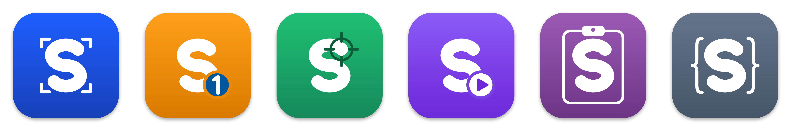

# uSuite

uSuite is Ur Suite, your suite: small, open-source utilities for the Mac, each one doing one job well. Its first family is sSuite, a set of tools that turn work done on screen into step-by-step evidence and guides. The s stands for super-fast, and for Swift.

Tour the tools, share them and support the work at [usuite.github.io](https://usuite.github.io/).

## Wait, another image viewer?

Fair question. macOS has Preview and Quick Look, and there are good free viewers and screenshot tools. sView alone would be hard to defend. But sView is not the point; the point is a job none of those tools do end to end.

The job: you walk through a procedure on screen (install something, configure it, prove a feature works) and need to hand over evidence or a guide, step by step: every screen captured at the same size, numbered in order, marked up with arrows and counters that continue from one step to the next, with a caption per step, ready for a report, and easy to fix when step 7 turns out wrong.

Look at what exists today:

- Viewers (Preview, qView, Pixea) show one folder of images. They do not know that a folder is a case, that the next folder is the next case, or that a memo beside the images describes them.
- Screenshot editors (Shottr, CleanShot X, Preview's markup) edit one image at a time and flatten it on save. There is no sequence, no shared style, no caption, and a typo on step 7 means redoing step 7.
- Step recorders (Scribe, Tango and friends) have the right idea, a procedure as a sequence of steps, but they keep your captures in their cloud, charge per seat and lock the format.

sSuite keeps the right idea and gives the files back to you. It is a chain of small tools around one plain folder per case:

| Tool | Job | State |
| --- | --- | --- |
| [sCapture](https://github.com/uSuite/scapture) | captures a window at a fixed size and scale into the active case folder, from a menu bar key | 0.1 |
| [sView](https://github.com/uSuite/sview) | views images and walks case folders from the keyboard, with the case memo beside the captures | 0.2 |
| [sNotate](https://github.com/uSuite/snotate) | annotates a case folder as one story and exports one image per step, a contact sheet and a Typst fragment | 0.2 |
| sWalk | renders a notated case as an animated clip with subtitles, no video editor involved | planned |
| [scommon](https://github.com/uSuite/scommon) | the Swift package they share: folders, natural sort, config and keymap | 0.3 |

Beside the chain, the same rules make everyday utilities. The first is [sPaste](https://github.com/uSuite/spaste), a clipboard history in a panel on Shift+Cmd+C that you walk with vim keys (`/` from the newest copy, `?` from the oldest) and filter by type and time; its history is a plain folder you can read. Version 0.1.

So yes, sView is an image viewer, and a good everyday one. It exists because the chain needs a reader that steps from case to case without a mouse, and it is built to the same rules as the rest.

## The rules every tool follows

- One job per tool. sCapture never edits, sNotate never captures, sView never changes a file. A tool that tries to do everything ends up doing the sequence badly.
- The folder is the document. A case is a folder of captures with a memo beside them. There is no database, no library to import into and no account; any tool, script or person can read it.
- Plain text everywhere. Settings, keymaps, annotation sidecars and memos are text files you can read, diff and keep in git. Annotations stay editable forever because they are never baked into the original.
- Originals are never touched. Captures stay as they were taken; exports go to their own folder, and deleting means the Trash.
- Keyboard first. sView and sNotate share one key grammar in the spirit of vim, kept in scommon for the tools to come: counts, `gg` and `G`, `:` commands, a keymap file. Every command is also in the menu bar.
- Native and fast. Swift and Apple frameworks only, no third-party dependencies, measured start-up and frame times, nothing running in the background that you did not ask for.
- Local and private. Nothing is uploaded, nothing phones home.

## Getting started

sView, sNotate and sPaste have a download on their releases pages ([sView](https://github.com/uSuite/sview/releases/latest), [sNotate](https://github.com/uSuite/snotate/releases/latest), [sPaste](https://github.com/uSuite/spaste/releases/latest)), a universal app for macOS 26 or newer. The downloads are signed ad hoc, not notarised, so macOS blocks the first open; each README's Install section shows how to allow it once. Every tool also builds from source with Xcode 26. To work on several at once, clone them side by side so that `../scommon` resolves; otherwise SwiftPM fetches scommon from GitHub.

## Why uSuite

sSuite is the name of the family, but the name was taken on GitHub, so the organization is uSuite: Ur Suite, since it is open source and yours to use and shape, or Utilities Suite, since that is what it holds. Tools beyond the s-family may join it later.

Everything here is MIT licensed. Issues and pull requests are welcome; see [CONTRIBUTING](https://github.com/uSuite/.github/blob/master/CONTRIBUTING.md).
